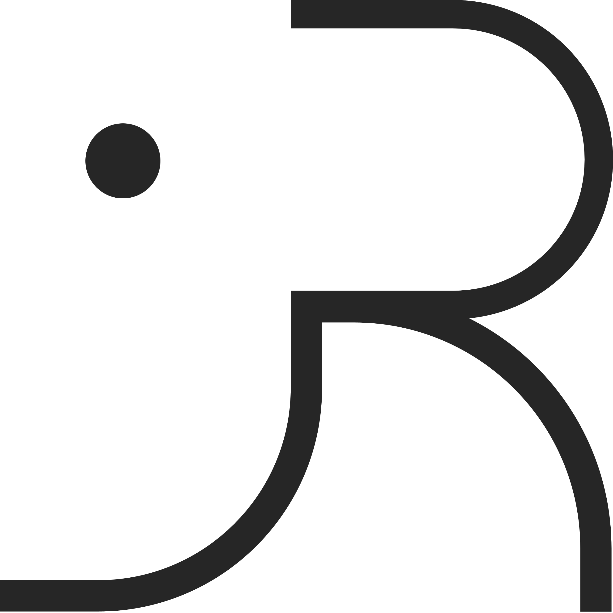
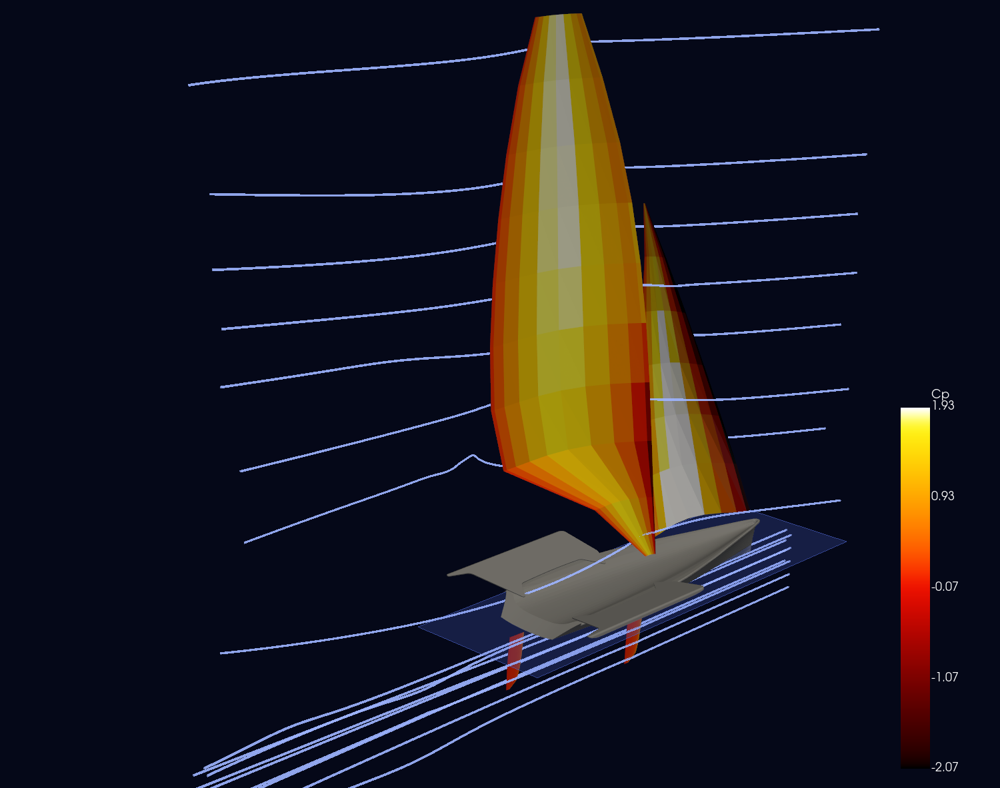
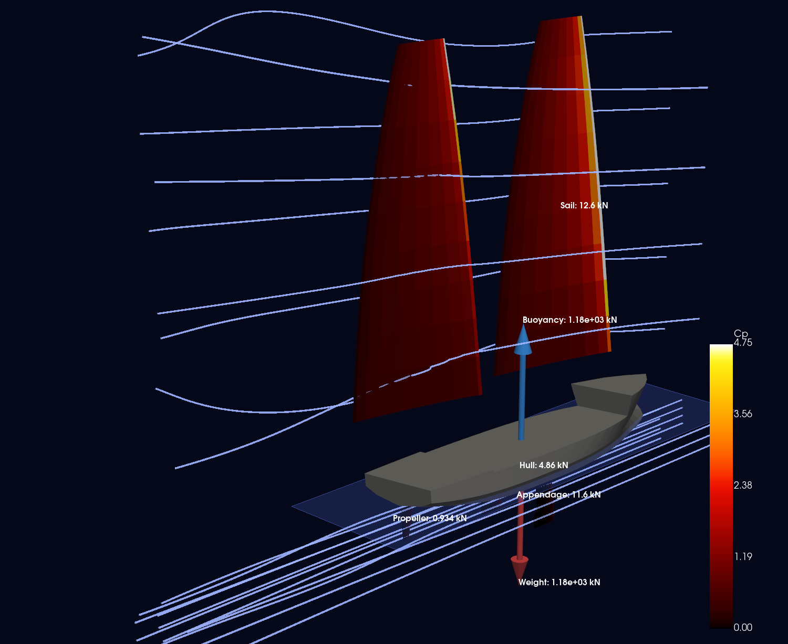
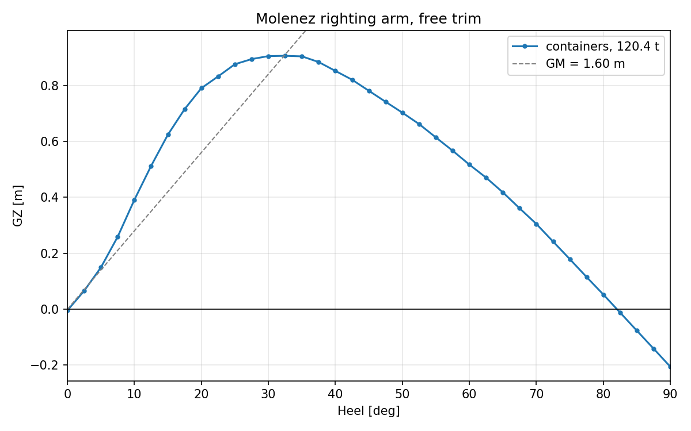

# Archibald 2.1.0 ⛵✏️

*by [Jules Richeux](https://github.com/julesricheux)*  <picture><source media="(prefers-color-scheme: dark)" srcset="media/logo-jr-light.png"></picture>

[](https://github.com/julesricheux/Archibald/actions/workflows/run-pytest.yml)
[](pyproject.toml)
[](https://pypi.org/project/archibald-design/)
[](LICENSE)

**Archibald is a Python 3 library for performance prediction and preliminary design of sailboats, motor boats and ships.** From a hull mesh, sail and foil outlines and a list of masses, it computes how the boat floats, heels, trims and sails.

- 🎓 Built for naval architects and engineers use cases in mind. Still under development, though its modules can already be used on their own.
- ✏️ Imports [Rhino](https://www.rhino3d.com) and [AutoCAD](https://www.autodesk.com/products/autocad/overview) drawings directly, so you can quickly test design choices and see how they affect performance.

<table>
    <tr>
        <td width="50%" valign="top">
            <a href="examples/03%20-%20Geometry/49er_sailboat_object.py"></a>
            <p align="center"><b>A skiff in 20 kt of wind.</b> Boat speed and leeway of a 49er, held upright, with placeholder masses.</p>
        </td>
        <td width="50%" valign="top">
            <a href="examples/03%20-%20Geometry/molenez_hybrid.py"></a>
            <p align="center"><b>A cargo ship under wings and propeller.</b> Draft, heel, trim, leeway and rpm of the Molenez, with the forces in balance. Yaw is not balanced and the propeller is a placeholder.</p>
        </td>
    </tr>
</table>

Hull, rig, appendages, foils and propellers all live in one model of the boat, and **any number in it can become an unknown**: a draft, a sail trim, a crew position, a pitch ratio. You choose what is free, which forces count and what must balance, and a gradient-based optimizer does the rest. The same model answers "how fast does she go?" and "what should I change to go faster?".

```bash
pip install archibald-design
```

> [!NOTE]
> Archibald 2.1 is still in development: its results and its interface can still change. Check [what has been validated](#how-far-can-you-trust-it) before relying on a number.

**[What it does](#what-can-you-do-with-it)** · **[Projects](#projects-built-with-archibald)** · **[Methods](#whats-inside)** · **[A first equilibrium](#a-first-equilibrium)** · **[Getting started](#getting-started)** · **[Validation](#how-far-can-you-trust-it)**

## ✍️ Projects built with Archibald

Archibald 1.0.0 was widely used in the following student projects:

<table>
    <tr>
        <td width="33%" valign="top">
            <p align="center">
                MOLENEZ II - Sailing general cargo ship for Ponant Islands feeding
            </p>
            
            
            
        </td>
        <td width="33%" valign="top">
            <p align="center">
                NEREUS - Fast humanitarian aid vessel (tested in Centrale Nantes' towing tank)
            </p>
            
            
            
        </td>
        <td width="33%" valign="top">
            <p align="center">
                PAKI'AKA - Radical and high-performance bamboo 18ft skiff
            </p>
            
            
        </td>
    </tr>
    <!-- PLACEHOLDER: new projects. Copy this row inside the table, one <td> per project (three per row), and uncomment.
    <tr>
        <td width="33%" valign="top">
            <p align="center">
                PROJECT NAME - One line on the boat
            </p>
            
        </td>
    </tr>
    -->
</table>

Used Archibald on a boat of yours? [Tell us about it](https://github.com/julesricheux/Archibald/issues).

## ⚡ What can you do with it?

Click an image to open the script that produced it.
<!-- 
### Stability
PLACEHOLDER: rename to "Stability and foiling" when the foiling figure below is added. -->
<!--
<table>
    <tr>
        <td width="50%" valign="top">
            <a href="examples/03%20-%20Geometry/molenez_gz_curve.py"></a>
            <p align="center"><b>Righting arm curves from the mesh.</b> Heel sweep with immersion and trim solved at every point. The hull is taken as watertight, with no downflooding.</p>
        </td>
        PLACEHOLDER: foiling figure. Set the image path and uncomment this cell.
        <td width="50%" valign="top">
            <a href="examples/03%20-%20Geometry/49er_foiling.py"></a>
            <p align="center"><b>Foil take-off.</b> The thrust hump, ride height and weight carried by the hull, on a 49er with a placeholder T-foil.</p>
        </td>
    </tr>
</table>
-->
### 🚢 Hull resistance

<table>
    <tr>
        <td width="50%" valign="top">
            <a href="examples/01%20-%20Validation/dsyhs_towing_tank.py"></a>
            <p align="center"><b>Delft Systematic Yacht Hull Series</b> against the tank data of 44 hulls. The published polynomial follows the data; the function as shipped reads low at high Froude numbers (<a href="examples/01%20-%20Validation/README.md#delft-systematic-yacht-hull-series">details</a>).</p>
        </td>
        <td width="50%" valign="top">
            <a href="examples/01%20-%20Validation/michell_wigley.py"></a>
            <p align="center"><b>Michell thin ship theory</b> on the Wigley hull, against an independent integration and measurements. The right magnitude, with the exaggerated humps and hollows the theory is known for.</p>
        </td>
    </tr>
    <tr>
        <td width="50%" valign="top">
            <a href="examples/01%20-%20Validation/holtrop_1982_example.py"></a>
            <p align="center"><b>Holtrop &amp; Mennen</b> against the worked example of the 1982 paper. The differences come from the later formulas used by the module.</p>
        </td>
        <td width="50%" valign="top">
            <a href="examples/01%20-%20Validation/added_resistance_waves.py"></a>
            <p align="center"><b>Added resistance in waves.</b> Mittendorf et al. on the KVLCC2 against another code (PRECAL), and the DSYHS table.</p>
        </td>
    </tr>
</table>

### ⛵ Multihulls

<a href="examples/01%20-%20Validation/multihull_interaction.py"></a>

<p align="center"><b>Interference between hulls</b> from thin ship theory and from regressions, at three separations. These models disagree with one another above Fn 0.37, and tank data is still needed to judge them.</p>

### 🌀 Propellers and windage

<table>
    <tr>
        <td width="50%" valign="top">
            <a href="examples/01%20-%20Validation/propeller_b_series.py"></a>
            <p align="center"><b>Wageningen B-series.</b> Open water curves against published design points. Rpm and pitch ratio can be unknowns of the equilibrium.</p>
        </td>
        <td width="50%" valign="top">
            <a href="examples/01%20-%20Validation/windage.py"></a>
            <p align="center"><b>Windage</b> of superstructures and crew. The two crew models are inverted between head and beam wind, an open point against the ORC document.</p>
        </td>
    </tr>
</table>

<!-- PLACEHOLDER: animated flow around a boat.
     Produce it with boat_sol.draw_vlm(gif_path="media/flow.gif", n_frames=150) from any example (needs imageio), then uncomment:
<p align="center"></p>
-->

## 🔎 What's inside

| On the boat | Methods |
|---|---|
| **Hydrostatics** | Immersed volume, centre of buoyancy and hydrostatic coefficients from the hull mesh, at any heel and trim |
| **Calm water resistance** | DSYHS, Holtrop & Mennen, Michell, Savitsky (planing) |
| **Hull side force** | Jones, Inoue, Kijima |
| **Added resistance in waves** | Savitsky & Brown, Mittendorf et al., DSYHS |
| **Multihull interaction** | Michell, Jamaluddin, Miyazawa, and your own Insel & Molland tables |
| **Sails, keels, rudders and foils** | Vortex lattice with NeuralFoil section polars and a wind gradient, with water or air density at each panel depending on its side of the free surface |
| **Propellers** | Wageningen B-series, with wake fraction and thrust deduction as inputs |
| **Windage** | Day, Blendermann, ORC |
| **Weights** | A list of masses with their centres of gravity, any of which can be unknown |
| **Drawing** | Interactive 3D views with pressure, animated streamlines and force arrows (PyVista, Plotly) |

Geometry comes in from your CAD tool: hulls as STL meshes, sails and foils as DXF outlines.

## 🐍 A first equilibrium

What draft, trim and rpm does a ship need at 8 kt? Three steps: what is free, what acts on the boat, what must balance. Run it from [`examples/03 - Geometry`](examples/03%20-%20Geometry/), where the hull mesh is. The mass is only illustrative.

```python
from archibald.dynamics.hydro import dsyhs
from archibald.geometry import Hull, Sailboat
from archibald.geometry.propeller import BSeriesPropeller
from archibald.optimization import Opti
from archibald.performance import OperatingPoint
from archibald.weights import MassProperties

# The boat: a hull mesh, a propeller, and the masses it carries
propeller = BSeriesPropeller(
    blades_number=4,
    blade_area_ratio=0.65,
    pitch_ratio=1.0,
    diameter=2.5,
    xyz_center=[1.0, 0.0, 0.5],
)
boat = Sailboat(
    hulls=[Hull(name="hull", mesh="data/molenez2_data/hull.stl")],
    propellers=[propeller],
    masses=[MassProperties(mass=124e3, x_cg=12.4, y_cg=0., z_cg=2.3)],
)

# What is free: any number can become a variable of the problem
opti = Opti()
draft = opti.variable(init_guess=1.3, lower_bound=0.2, upper_bound=4.)   # [m]
trim = opti.variable(init_guess=0., lower_bound=-10., upper_bound=10.)   # [deg], positive bow down
propeller.rpm = opti.variable(init_guess=150., lower_bound=30.)          # [rpm]
op_point = OperatingPoint(stw=8., dz=-draft, trim=trim)                  # 8 kt through the water

# What acts on the boat
boat.compute_weight(op_point)
boat.compute_buoyancy(op_point)
boat.compute_resistance(
    op_point,
    method={
        "Rf": dsyhs.compute_Rf_dsyhs,
        "Rw": dsyhs.compute_Rw_dsyhs,
        "Rtr": dsyhs.compute_Rtr_dsyhs,
    },
    Csternchoice=1,
    Bulbchoice=0,
)
boat.compute_propellers(op_point, wake_fraction=0.2, thrust_deduction=0.15)
Ftot, Mtot = boat.compute_torsor(op_point)

# What must balance: surge, heave and pitch
sol = boat.find_equilibrium(
    opti,
    Ftot,
    Mtot,
    dofs=["Fx", "Fz", "My"],
    force_scale=1e4,
    moment_scale=1e5,
    verbose=False,
)

print(f"Draft {sol(draft):.2f} m, trim {sol(trim):+.2f} deg, {sol(propeller.rpm):.0f} rpm")
print(f"Brake power {sol(propeller.performance)['BHP'] / 1e3:.0f} kW")
```

```text
Draft 1.27 m, trim +0.34 deg, 86 rpm
Brake power 29 kW
```

Add `opti.minimize(...)` and the same script becomes a design optimization: [`molenez_propulsion.py`](examples/03%20-%20Geometry/molenez_propulsion.py) also moves cargo to stay upright and picks the pitch ratio for the least power.

## 🏁 Getting started

```bash
pip install archibald-design
```

This needs Python 3.11 or later.

Then pick the folder that fits:

| Folder | What you get |
|---|---|
| [`00 - Templates`](examples/00%20-%20Templates/README.md) | **Start here for your own boat.** Fill-in templates for a motor ship, a cruising monohull, a multihull, a planing boat, a foiling motorboat and a foiling racing monohull |
| [`01 - Validation`](examples/01%20-%20Validation/README.md) | Each model against published data, with its figures |
| [`02 - Modeling`](examples/02%20-%20Modeling/) | Fitting and interpolation tools for your own data |
| [`03 - Geometry`](examples/03%20-%20Geometry/) | Examples on real geometry: the Molenez cargo sailboat, the 49er skiff, the Nacra 15 catamaran |

An operating point takes speeds in knots and angles in degrees. Axes are x forward, y to port, z up, with the water at z = 0.

## ✅ How far can you trust it?

Archibald is an engineering-level tool for preliminary design, and its methods hold only within their range of validity. The [validation page](examples/01%20-%20Validation/README.md) states for each model what it was compared with, what agrees, what does not, and which data is still missing. Few of these comparisons are against measurements so far, and some methods are not validated at all.

Tank results, published tables and a number that looks wrong are all welcome, and you do not need to write code to help: see [how to contribute](CONTRIBUTING.md).

## 🙏 Credits

Archibald is forked from the amazing [AeroSandbox](https://github.com/peterdsharpe/AeroSandbox) by [Peter Sharpe](https://peterdsharpe.github.io/), the source of its optimization framework and vortex lattice core. Section polars come from [NeuralFoil](https://github.com/peterdsharpe/NeuralFoil), also by [Peter Sharpe](https://peterdsharpe.github.io/), and the equations are solved with [CasADi](https://github.com/casadi/casadi) and IPOPT. Archibald 2.0 was developed during the author's time at [NEOLINE](https://www.neoline.eu/).

The papers behind each method are cited in the docstring of its module.

## 🤝 Contributing

See how you can [help Archibald evolve](CONTRIBUTING.md).

## ⚖️ License

[MIT](LICENSE).
