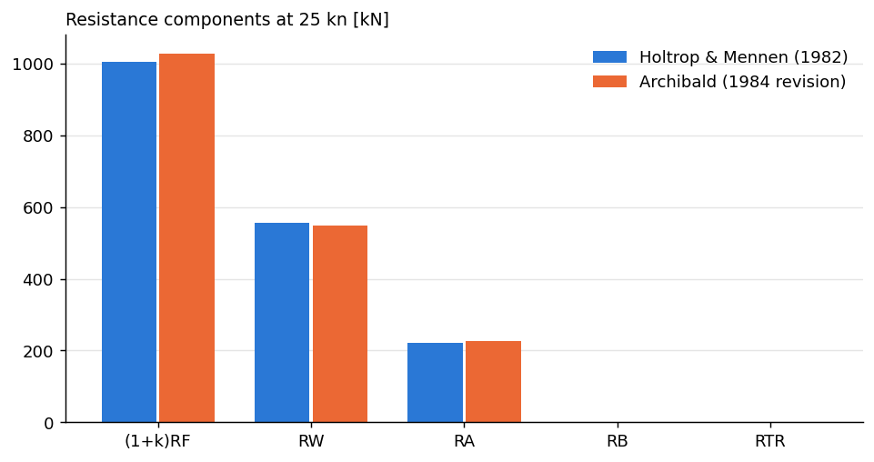
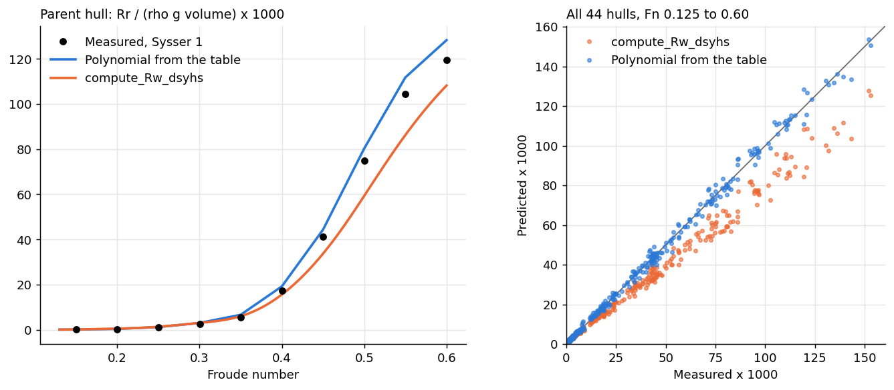
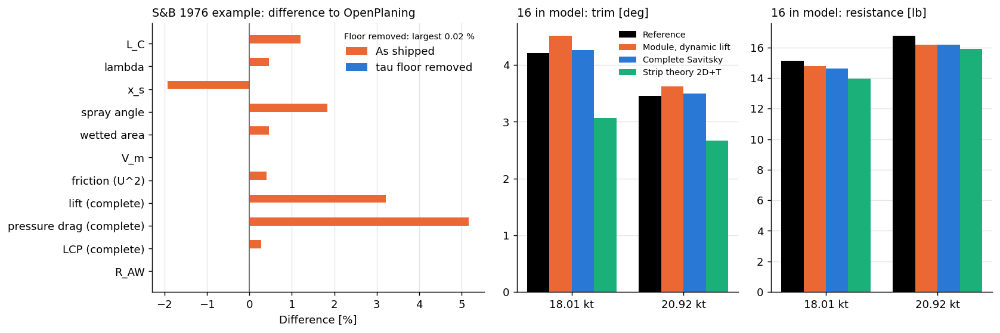
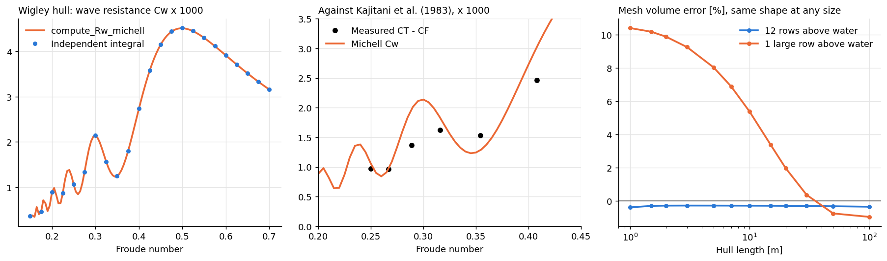
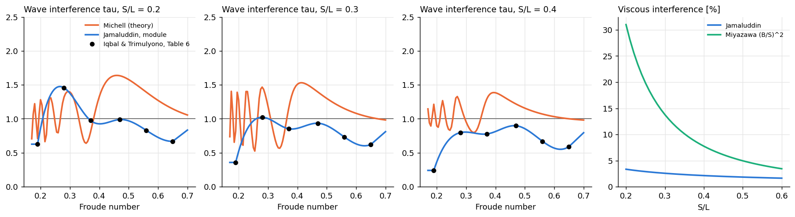
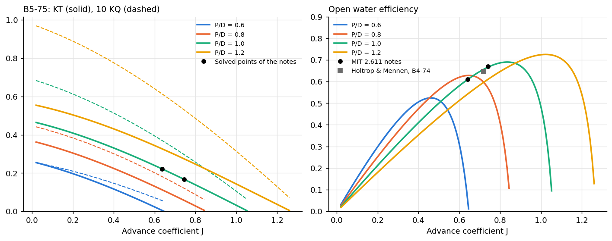
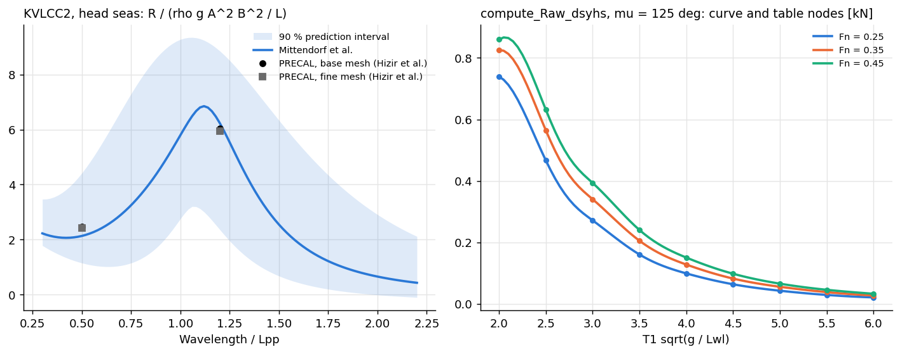
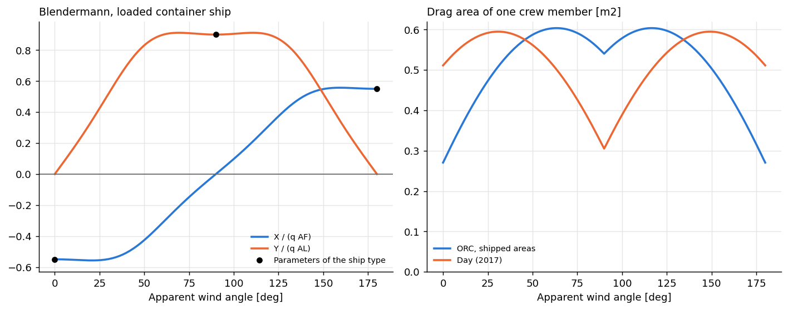
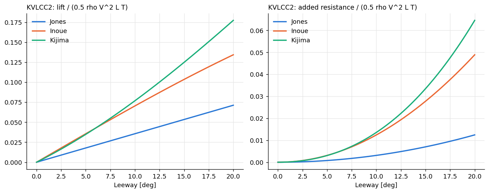

# Validation of the literature models

Each script compares a model of Archibald with numbers from outside the package, prints a comparison table and saves a figure in `figures/`.

Run a script from this folder:

```bash
python holtrop_1982_example.py
```

The numbers that must not move are also kept as tests, in `archibald/dynamics/hydro/test_validation_published.py` and `archibald/dynamics/aero/test_windage_published.py`.

This page says what has been shown and what has not. "Validated" would be too strong for most lines of the table below. Few of them compare with a measurement, and several only check that the code does what the paper's formula says (verification).

## Status

| Model | Module | Compared with | Result |
|---|---|---|---|
| Holtrop & Mennen, resistance and propulsion | `holtrop.py` | Worked example of the 1982 paper | **Reproduced**, within 0.4 % on the 1982 terms. The module uses later formulas for a few terms, so those differ as expected. Four errors were found and fixed |
| DSYHS, residuary resistance | `dsyhs.py` | Tank data: 44 hulls, 461 points (4TU, CC0) | **Differs.** The polynomial is right, but the shipped function moves away from it: -26 % at Fn 0.5 |
| DSYHS, added resistance in waves | `dsyhs.py` | Its own table | Table reading checked at 225 nodes. **The table itself is not checked**: awaiting its source |
| Savitsky, planing | `savitsky.py` | S&B 1976 example as computed by OpenPlaning | **Reproduced** to 0.02 % once the trim is corrected. **As shipped, the trim is altered**: +1.9 %, so +5 % on pressure drag. Printed values of the paper: awaiting input |
| Savitsky, added resistance in rough water | `savitsky.py` | Same case | Reproduced, -0.02 % |
| Strip theory 2D+T | `strip_theory.py` | 16 in model | Compared only. Research model, with a guessed length and height of CG. **Not validated** |
| Michell, thin ship | `michell.py` | Independent integration of the integral, Wigley hull | **Reproduced** to -0.1 to -0.5 % (-1.2 % at Fn 0.15), explained by the truncation |
| Michell, against measurement | `michell.py` | Kajitani et al. 1983, through Ahmed et al. 2015 | Right magnitude. Humps and hollows are exaggerated, as thin ship theory is known to do |
| Jamaluddin, catamaran interference | `jamaluddin.py` | Iqbal & Trimulyono 2014, secondary source | Reproduced, 0.08 % at most. **Not tank data** |
| Insel & Molland, catamaran interference | `insel_molland.py` | Table reader only, a B-spline on the user's table | No data shipped: awaiting input |
| Miyazawa, viscous interference | `miyazawa.py` | Nothing | **Not validated.** Its values look large: 31 % at S/L 0.2 |
| Wageningen B-series | `propeller.py` | MIT 2.611 notes, and Holtrop 1982 p. 170 | **Reproduced** within 0.63 % and 1 %, at the precision of the sources. Bernitsas et al. 1981 values: awaiting input |
| Mittendorf et al., added resistance | `mittendorf.py` | PRECAL potential code, KVLCC2 | Inside the method's 90 % interval: -13 % at lambda/L 0.5, +3.3 % at 1.2. **Another code, not a measurement** |
| Day, windage | `day.py` | Equations of the paper | Agrees with the equations, within 0.23 %. No published force found |
| Blendermann, windage | `blendermann.py` | Blendermann 2004, Table 3 | CDt and kappa confirmed. CDlAF and delta: awaiting input |
| ORC, windage | `orc.py` | Nothing | Document not found: awaiting input. Its crew areas disagree with Day (see below) |
| Jones, Inoue, Kijima, lateral force | `jones.py`, `inoue.py`, `kijima.py` | Formulas by hand | Formulas checked. **Not validated**: no published derivative has been read yet |
| Radojcic, Mercier & Savitsky | `radojcic.py`, `mercier_savitsky.py` | Nothing | They raise `NotImplementedError`, because their coefficients have not been supplied |

## Holtrop & Mennen (1982)

`holtrop_1982_example.py`: the example of p. 170 of the paper. Nearly every intermediate value is printed there, so errors can be located.



The Froude number, `RF`, `c7`, `c1`, `c3`, `c2`, `c5`, `c15`, `lambda`, `LR`, `CP1`, `c11`, `etaR`, `Pb` and the bulb terms agree within 0.4 %. `m1` differs by 0.13 % because the module divides by `T + 0.1`.

These differ because the module uses revised formulas, which the 1984 paper seems to be the source of (it could not be read):

| Term | Paper | Archibald |
|---|---|---|
| `1 + k` | 1.156 | 1.1851 |
| `RW` [kN] | 557.11 | 549.16 |
| `CA` | 0.000352 | 0.000363 |
| `w` | 0.2584 | 0.27505 |
| `Rtotal` [kN] | 1793.26 | 1812.9 |

Errors fixed in `holtrop.py`, where the code contradicted pp. 169-170 of the paper:

- `c_3` is `0.56 * Abt ** 1.5`. It was `(0.56 * Abt) ** 1.5`, which gave `c3` 0.01586 against 0.02119 printed, and `RW` 3.8 % too high.
- `w_single_open_stern` was another formula and raised `TypeError`.
- `w_twin` raised `TypeError`.
- `eta_R_twin` had the wrong sign on `P / D`.

## Delft Systematic Yacht Hull Series

`dsyhs_towing_tank.py`: the measured upright bare hull resistance of 44 hulls against two predictions, the polynomial of the paper with its table of coefficients, and the shipped `compute_Rw_dsyhs`. The data are the public 4TU sets by den Ouden.



Mean absolute error of `Rr / (rho g V) x 1000`:

| Fn | Measured mean | Error, table polynomial | Error, shipped |
|---|---|---|---|
| 0.125-0.2 | 0.18 | 0.10 | 0.14 |
| 0.2-0.3 | 1.08 | 0.19 | 0.25 |
| 0.3-0.4 | 6.77 | 0.59 | 0.88 |
| 0.4-0.5 | 35.62 | 1.43 | 7.56 |
| 0.5-0.6 | 84.14 | 2.67 | 16.39 |

The shipped function differs because `smooth_clip(Fr, 0, 0.6, beta=10)` is too soft: Fn 0.35 is evaluated at 0.345, Fn 0.5 at 0.469 and Fn 0.15 at 0.169. On the parent hull, the shipped value is +131 % at Fn 0.15, -9 % at 0.35, -26 % at 0.5. With `beta=100` it matches the table within 0.00 % up to Fn 0.55 and -1 % at 0.6, but the effect on solvers has not been tested.

**Not changed**, because it moves every result of the Molenez and Nacra examples.

## Savitsky

`savitsky_planing.py`. The paper of Savitsky & Brown (1976) could not be read. Its example is taken from the README of OpenPlaning (MIT), another implementation, so this is a comparison between codes.



- With the input trim corrected, wetted length, spray angle, area, mean velocity, lift, pressure drag and centre of pressure agree within 0.02 %.
- As shipped, `tau = softplus(trim, beta=1)` changes the trim: 1° becomes 1.31°, 2° becomes 2.13°, 2.88° becomes 2.94°. This gives +1.2 % on chine length, +3.2 % on lift and +5.2 % on pressure drag. `beta=10` would remove it, and a commented line in the code already does so. **Not changed.**
- Friction is 1.54 % lower than OpenPlaning, entirely because OpenPlaning uses `U²` and Savitsky `V_m²`. The module follows Savitsky.
- The module computes the dynamic lift only: -70 % on lift and +59 % on the centre of pressure at Cv 1.5 are by design, as the hydrostatics module supplies the rest.
- Case 2, a 16 in model: the reference values come from a script in the repository and their origin is unconfirmed.
- `compute_Rsp_savitsky` is not validated.

## Michell

`michell_wigley.py`, on the Wigley hull, which the equivalent hull of the module represents exactly.



- Against an independent integration: -0.10 to -0.49 % from Fn 0.2 up, and -1.23 % at Fn 0.15. This comes from truncating the integral at `depth_decay=16`.
- Two coincident hulls give exactly four times the resistance of one.
- Through a mesh and `Hull`: 141.03 kN against 140.33 kN from the exact coefficients, with hydrostatic coefficients within 0.6 %.
- Against Kajitani et al. (1983): the form factor implied by `CT - CF - Cw` is 0.87 to 1.06, and below 1 means Michell overestimates. It is not steady, because thin ship theory exaggerates humps and hollows. The model size is not given in the source, so `CF` assumes L = 1 m.

## Multihull interaction

`multihull_interaction.py`.



- Jamaluddin: reproduces Tables 5 and 6 of Iqbal & Trimulyono (2014) within 0.08 %. It is a secondary source, not tank data.
- Between its six fitted Froude numbers, tau is a cubic B-spline (`InterpolatedModel`), an assumption since the source gives the fits only. The spread between interpolations shows how loose this is: at Fn 0.23 and S/L 0.2, linear interpolation gives 1.00 and the spline 1.31. The spline overshoots the fitted values by 1.3 % at S/L 0.2, near Fn 0.27, and dips to 0.55 at S/L 0.4 between 0.67 and 0.59.
- Michell's interaction factor and Jamaluddin's disagree above Fn 0.37. Michell gives 1.3 to 1.6 at S/L 0.2, Jamaluddin below 1. A regression absorbs the error of thin ship theory, so only the trends are comparable. Tank data are needed to judge.
- The Michell factor varies strongly with Cp: 1.15 at Cp 0.693, 1.39 at 0.65, 0.87 at 0.75 (Fn 0.37, S/L 0.3). The Cp of 0.693 for NPL 5b comes from memory and is not verified.
- Miyazawa gives 31 %, 14 % and 8 % at S/L 0.2, 0.3 and 0.4, against 3.4 %, 2.6 % and 2.1 % for Jamaluddin. These are large against the note of the module itself, and its source has not been read.
- With the default `n_u=401`, large separations alias: the factor is off by up to 5 % at S/L 50.
- `compute_dRw_michell(calibrate=True)` does nothing by default, because `s_max=1` clips the calibration to 1. Tested with `Rw` at 0.25 and 4 times Michell: the result is unchanged, and correct with `s_max=3`.

## Wageningen B-series

`propeller_b_series.py`.



- B5-75, P/D 1, against the MIT 2.611 notes: within 0.63 %, and these notes give two digits only.
- Holtrop's example: P/D is not printed, so it is solved from `KT` (1.0367). `KQ` agrees within 1 % under every reading of the Reynolds correction, and the closest gives +0.15 %.

## Added resistance in waves

`added_resistance_waves.py`.



- Mittendorf et al. on the KVLCC2, against PRECAL as computed by Hizir et al. (2019). This is another method, with no measurement. `Le` and `Lr` come from a commented example in the module.
- The docstring of `mm_raw` swaps "lower" and "upper": output 1 is the upper bound.
- DSYHS: the 225 nodes of the table are read back within 3e-8 %. 7 entries of the table are zero, and interpolating towards them gives negative resistance between the nodes: 51 of 9430 points, -784 N at worst. The table's origin is not referenced in the code.

## Windage

`windage.py`.



Day and Blendermann agree with the equations and limits that could be read. The drag area of one crew member is inverted between the models, which should be looked at against the ORC document:

| Drag area [m²] | Head wind | Beam wind |
|---|---|---|
| ORC, shipped | 0.271 | 0.540 |
| Day | 0.511 | 0.305 |

## Lateral force

`lateral_force.py`. Only formulas by hand so far. KVLCC2 linear lift derivative: Jones 0.204, Inoue 0.410, Kijima 0.354. Cp and Cwp of the KVLCC2 are assumed here. This is not a validation until published derivatives are entered.



## Mesh hydrostatics

Found while building the Wigley case. `ArchibaldMesh.hydrostatics` smooths with lengths fixed in metres, so its error depends on the size of the hull when a large face touches the waterline from above. With a single large row above water, the volume error is +10.4 % at 1 m, +5.4 % at 10 m, +0.4 % at 30 m and -1.0 % at 100 m. With 12 rows above water it stays between -0.3 and -0.4 % at any size. This matters for small hulls with large faces at the waterline.

## Open inputs

The files in `data/` with a `# TO FILL` header have no data yet. Each script prints `[INPUT NEEDED]` for them and carries on. Rows added there are compared and plotted without changing the script. Every blank was tested with dummy rows.

| File | What is needed | Why |
|---|---|---|
| `savitsky_brown_1976_example.csv` | Printed values of the example, Marine Technology 13(4), 1976 | Replaces a comparison between codes with the source |
| `chambliss_boyd_tn2876.csv` | Lift and drag of prismatic surfaces, NACA TN 2876 | The only planing measurements in the list (PDF above 10 MB, could not be read here) |
| `wigley_wave_resistance.csv` | A table of thin ship or wave cut `Cw` | Direct check of Michell |
| `insel_molland_tables.csv` | Interference factors of the NPL series | Tank data for all interference models (the Southampton repository has a bot check, which was not circumvented) |
| `bernitsas_kt_kq_points.csv` | Points from the 1981 report | Three digit check of the B-series |
| `kvlcc2_caw_experiment.csv` | Tank added resistance, Fn 0.142 | Mittendorf against measurements |
| `dsyhs_added_resistance_points.csv` | The source of the a and b tables | The table cannot be traced otherwise |
| `orc_vpp_windage.csv` | ORC VPP documentation, section 5.3 | The crew areas are marked "to be checked" in `orc.py` |
| `blendermann_1994_parameters.csv` | Table of the 1994 paper | CDlAF and delta |
| `kvlcc2_derivatives.csv` | Published hull derivatives | Lateral force methods |

Also needed: the coefficients of Radojcic (2014, annex 1) and of Mercier & Savitsky (1973, DTIC AD-764 958), and the Holtrop & Mennen (1984) paper.

## Data and licences

`data/dsyhs_hydrostatics.csv` and `data/dsyhs_bare_hull_upright.csv` are extracts of two CC0 sets by den Ouden. All other reference numbers are short values cited from their sources, as listed in the docstring of each script.

## Sources

- Holtrop & Mennen, "An approximate power prediction method", International Shipbuilding Progress 29, 1982.
- den Ouden, "Delft Systematic Yacht Hull Series Measurement Data" ([10.4121/21501402.v1](https://doi.org/10.4121/21501402.v1)) and "hydrostatics data" ([10.4121/21501375.v1](https://doi.org/10.4121/21501375.v1)), 4TU.ResearchData.
- [OpenPlaning](https://github.com/elcf/python-openplaning), README and source (MIT), for the example of Savitsky & Brown, Marine Technology 13(4), 1976.
- Ahmed, Yaakob, Rashid & Elbatran, [Journal of Transport System Engineering 2(1), 2015](https://jtse.utm.my/index.php/jtse/article/download/35/26), Table 5, for Kajitani et al. (1983).
- Iqbal & Trimulyono, [KAPAL 11(3), 2014](https://ejournal.undip.ac.id/index.php/kapal/article/download/7735/6377).
- MIT 2.611, [KT and KQ design notes](https://ocw.mit.edu/courses/2-611-marine-power-and-propulsion-fall-2006/b921c150102f7aaad1edb11b826e119d_03kt_kq_design.pdf).
- Hizir, Kim, Turan & Day, [Int. J. Naval Architecture and Ocean Engineering 11, 2019](https://strathprints.strath.ac.uk/63500/9/Hizir_etal_IJNAOE_2018_Numerical_studies_on_non_linearity_of_added_resistance.pdf).
- Mittendorf, Nielsen, Bingham & Liu, [Ocean Engineering 251, 2022](https://orbit.dtu.dk/en/publications/towards-the-uncertainty-quantification-of-semi-empirical-formulas/).
- Day, ["Performance prediction for sailing dinghies"](https://strathprints.strath.ac.uk/59980/), Ocean Engineering, 2017.
- Blendermann, [Wind loading of ships, 2004](https://tore.tuhh.de/bitstreams/218b134c-dcc0-4b92-8467-ead1d6787998/download).
